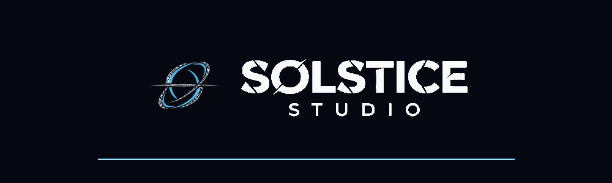



  

<h3 align="center">Have It Your Way.</h3>

  Bespoke local developer tooling, custom Android builds, real-time SSH pipelines & full-stack web systems.

---

### Featured Projects

| Project | Stack | What It Does |
| :--- | :--- | :--- |
| **[Solstice Local Command](https://github.com/ellysaemichan21/solstice-local-command)** | C# WPF · PHP 8 · Apache | Frameless dark-obsidian WAMP replacement with dynamic tray icon, zero-terminal service control & solstice.local dashboard. |
| **[Solstice Media Player](https://github.com/ellysaemichan21/solstice-media-player)** | Kotlin · Jetpack Compose · Media3 | Custom Obsidian & Electric Cyan Android video player fork (GPLv3) with auto-scanning folder library & Solstice emblem. |
| **[Felix Bridge](https://github.com/ellysaemichan21/felix-bridge)** | Python · Paramiko · SFTP/SSH | Real-time (<50ms) SFTP/SSH file-sync pipeline & terminal GUI built as a lightweight alternative to IDE SSH extensions. |

---

### Core Stack

  
  
  
  
  
  

